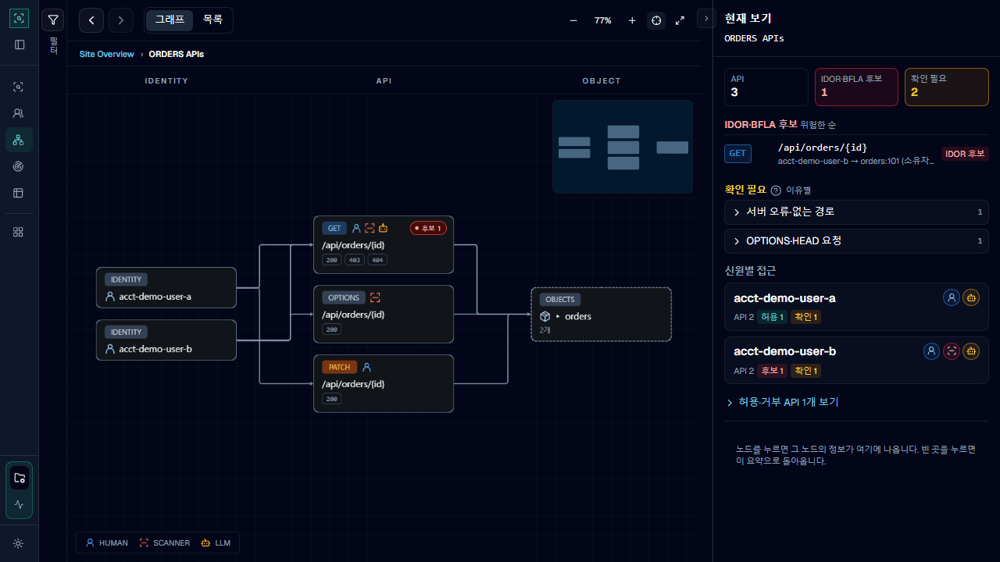
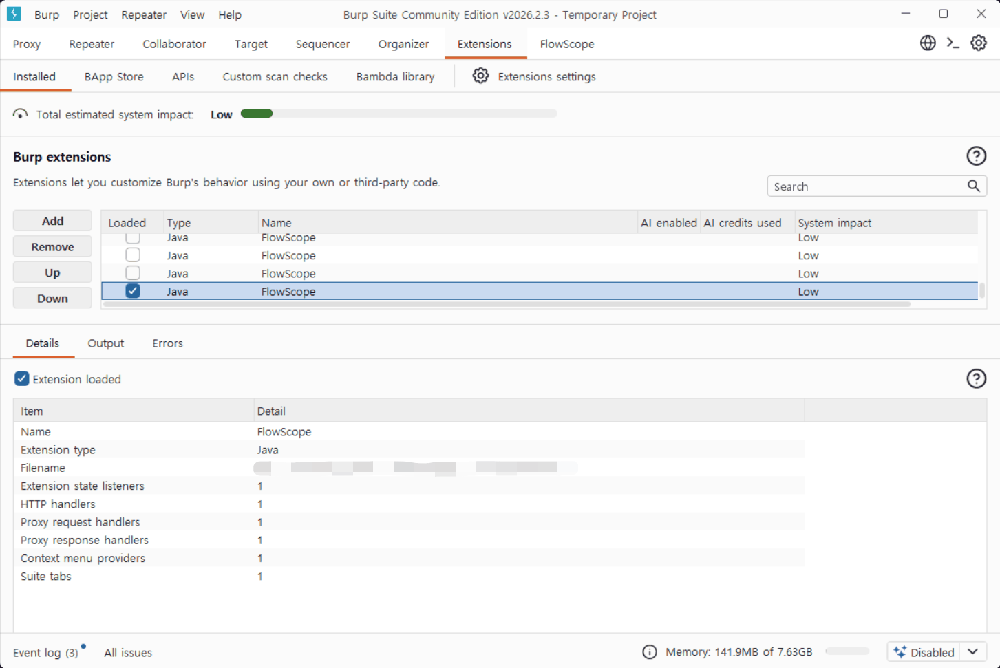
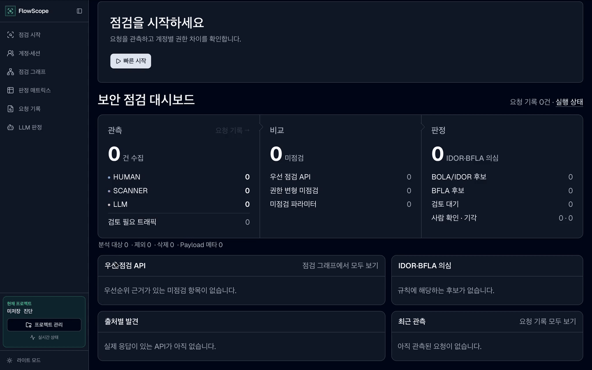
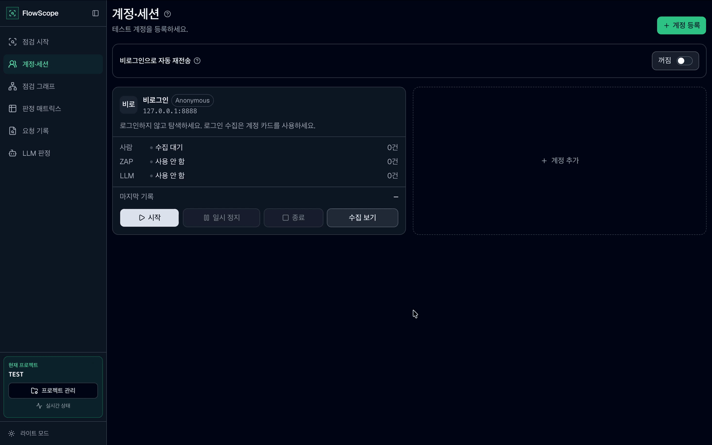
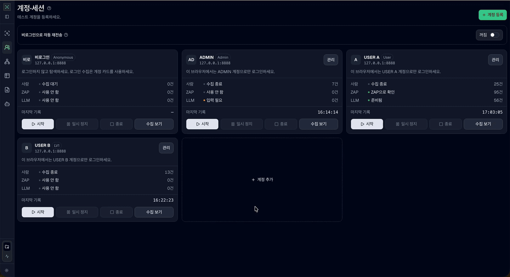
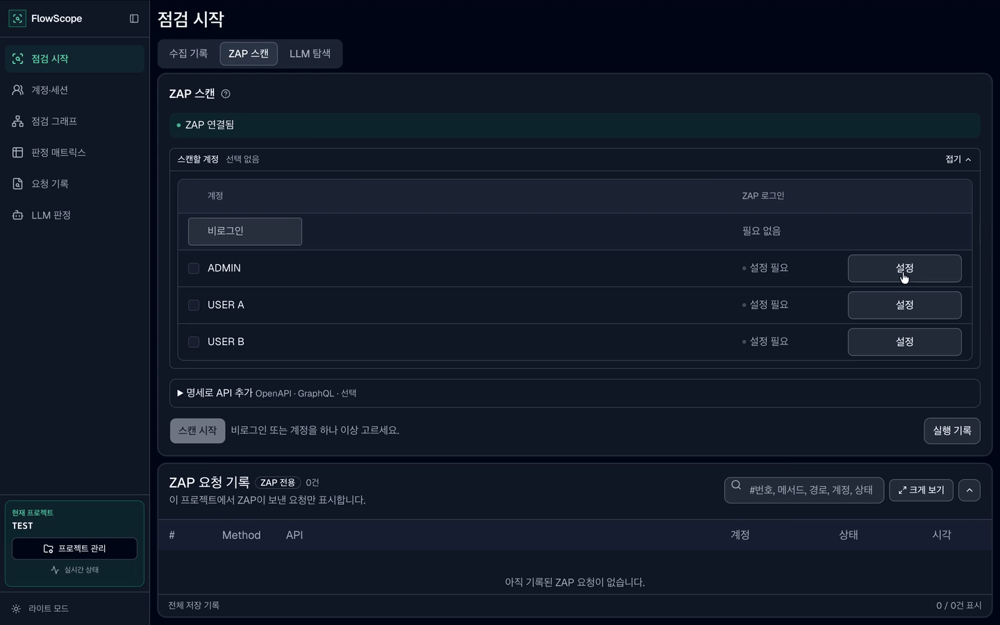
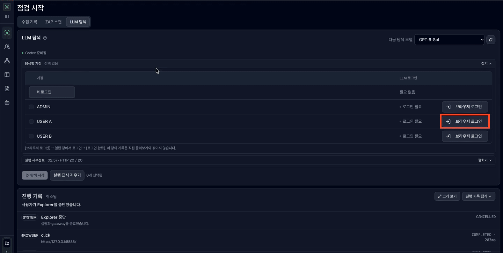
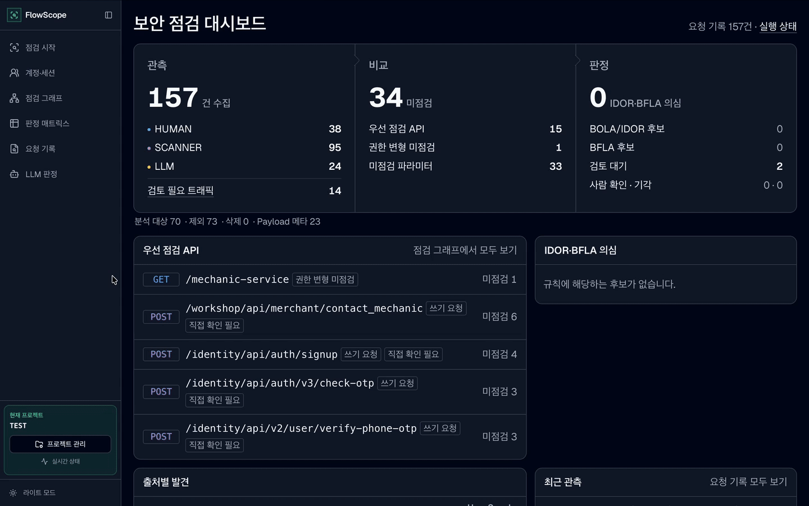
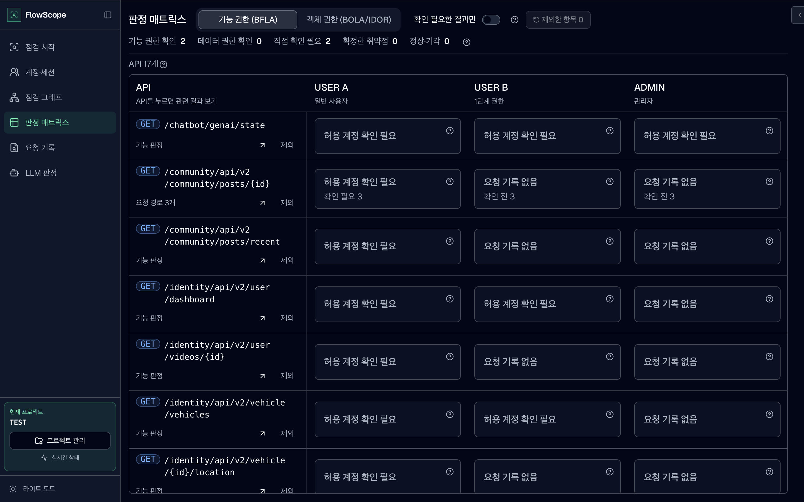

# FlowScope

**Burp Suite 기반 웹·API 탐색 및 접근통제 분석 도구**

HUMAN·ZAP·LLM의 탐색 결과를 통합하고, 계정–API–객체 관계와 미점검 구간을 시각화합니다. 수집한 요청을 다른 계정으로 재전송해 IDOR·BOLA·BFLA 후보를 검증할 수 있습니다.



[설치](#설치) · [첫 점검](#첫-점검) · [문서](docs/README.md) · [릴리스](https://github.com/TokenManiZo/flowscope/releases) · [문제 해결](docs/troubleshooting.md)

> [!WARNING]
> 점검 허가를 받은 테스트 환경과 테스트 계정에만 사용하세요. FlowScope는 대상 서버에 실제 요청을 보냅니다. 취약점 후보의 최종 확정은 사람이 수행합니다.

## 왜 FlowScope인가

인가 취약점 분석은 API를 찾는 것에서 시작합니다. FlowScope는 HUMAN·ZAP·LLM의 탐색 결과를 비교해 놓친 API와 미점검 계정 조합을 찾고, 그래프·판정 매트릭스에서 확인한 후보를 재전송 검증으로 이어갑니다.

## 핵심 기능

- **탐색 결과 통합** — HUMAN·ZAP·LLM이 찾은 API와 탐색 차이 비교
- **접근 관계 시각화** — 계정·API·객체 그래프와 판정 매트릭스
- **재전송 기반 검증** — 다른 계정·비로그인 접근 결과 비교, LLM 재검증 소견 제공
- **분석 근거 확인** — 실제 HTTP 요청·응답에서 후보의 근거 확인

## 요구사항

| 기능 | 필요한 환경 |
|---|---|
| 기본 사용·HUMAN 수집 | Burp Suite Community 또는 Professional |
| ZAP 스캔 | Docker Desktop(macOS·Windows) 또는 Docker Engine + Compose v2(Linux) |
| LLM 탐색·판정 | Codex CLI와 ChatGPT 로그인 |
| 소스 빌드 | JDK 21·Maven 3.9 |

Windows 실행 스크립트는 [PowerShell 7](https://learn.microsoft.com/powershell/scripting/install/install-powershell-on-windows)을 사용합니다. 확인한 버전은 Burp Community `2026.2.3`·`2026.7.3`, ZAP `2.17.0`, JDK `21`입니다.

## 설치

### 1. 내려받기

[Releases](https://github.com/TokenManiZo/flowscope/releases)에서 `flowscope-<버전>-bundle.zip`을 받아 압축을 풉니다. JAR과 실행·환경 점검 스크립트가 포함되어 있습니다. JAR만 필요하면 `flowscope-<버전>.jar`를 받으세요.

아래 스크립트는 압축을 푼 폴더에서 실행합니다. Windows에서는 PowerShell 7에서 `Get-ChildItem -Recurse | Unblock-File`을 먼저 실행하세요.

### 2. Burp에 FlowScope 추가하기

**Extensions → Installed → Add → Java**에서 JAR을 선택하고 **Next**를 누릅니다. 이전 버전은 제거하고 FlowScope 하나만 활성화하세요.



### 3. Docker 설치하기 (ZAP을 쓸 때만)

[macOS](https://docs.docker.com/desktop/setup/install/mac-install/) · [Windows](https://docs.docker.com/desktop/setup/install/windows-install/) · [Linux](https://docs.docker.com/engine/install/) 안내에 따라 설치합니다. Docker Desktop은 실행해 두고, `docker compose version`으로 Compose v2를 확인하세요.

### 4. ZAP 켜기 (ZAP을 쓸 때만)

```bash
./scripts/zap-up.sh             # macOS / Linux
```

```powershell
.\scripts\zap-up.ps1            # Windows
```

처음 실행할 때 이미지를 내려받고 빌드하므로 인터넷과 약 4.3GB의 디스크 공간이 필요합니다. `FlowScope ZAP is ready`가 나오면 준비 완료입니다. **ZAP용 Burp 리스너는 자동으로 생성·활성화됩니다.** Linux Docker Engine의 추가 설정과 연결 오류는 [문제 해결](docs/troubleshooting.md#zap)을 참고하세요.

### 5. Codex 설치하기 (LLM 탐색을 쓸 때만)

[Codex CLI 설치 안내](https://learn.chatgpt.com/docs/codex/cli)에 따라 설치하고, Burp를 실행하는 것과 같은 OS 사용자로 `codex`를 실행해 **Sign in with ChatGPT**로 로그인합니다.

설치 후 Burp를 다시 시작하고 **점검 시작 → LLM 탐색**에서 **Codex 준비됨**을 확인하세요. [연결 문제 해결](docs/troubleshooting.md#llm-탐색)

### 6. 환경 점검하기

필요한 기능에 맞춰 `human`, `zap`, `explorer`, `full` 모드를 선택합니다.

```bash
./scripts/doctor.sh --mode full       # macOS / Linux
```

```powershell
.\scripts\doctor.ps1 -Mode full       # Windows
```

## 첫 점검

연습용 대상이 필요하면 [OWASP crAPI](https://github.com/OWASP/crAPI)나 [OWASP Juice Shop](https://github.com/juice-shop/juice-shop)을 로컬에서 실행하세요.

### 1. 웹 화면 열기

Burp **FlowScope** 탭에서 **FlowScope Web UI 열기**를 누릅니다. 열리지 않으면 옆의 **주소 복사**로 브라우저에서 직접 접속하세요.

### 2. 점검 범위 정하기

**프로젝트 관리 → 새 프로젝트**에서 **점검 대상 주소**를 입력하고 **추가 → 프로젝트 만들고 열기**를 누릅니다.



`http://127.0.0.1:8888`처럼 프로토콜·포트까지 입력하세요. 여러 주소나 특정 경로를 지정할 수 있으며, 범위 밖의 요청은 저장하지 않습니다.

### 3. 계정 등록하기 (선택)

**계정·세션 → 계정 등록**에서 표시 이름·역할·대상 서비스를 등록합니다. 비밀번호는 이 단계에서 입력하지 않습니다.



계정 간 권한 비교에는 서로 다른 일반 계정 2개를 권장합니다. 비로그인 점검만 한다면 **비로그인** 카드를 사용하세요.

### 4. 점검 시작하기

HUMAN만 사용해도 됩니다. ZAP과 LLM은 선택 사항이며, 두 자동 탐색은 동시에 실행할 수 없습니다.

#### HUMAN · 직접 둘러보기

**계정·세션 → 사용할 계정의 시작**을 누르고, 열린 브라우저에서 로그인·탐색한 뒤 **종료**합니다.



**일시 정지**는 기록만 멈추며 **시작**으로 재개합니다. 다른 계정으로 바꿀 때는 **종료** 후 그 계정으로 새로 시작하세요. Burp **Intercept**는 꺼 두세요.

#### ZAP · 스캐너 탐색

**계정 관리 → ZAP 로그인**에서 설정·로그인 검증을 마친 뒤, **점검 시작 → ZAP 스캔**에서 계정을 선택하고 **스캔 시작**을 누릅니다.



비로그인 스캔은 로그인 설정 없이 실행할 수 있습니다.

#### LLM · 브라우저 자동 탐색

**점검 시작 → LLM 탐색 → 브라우저 로그인**으로 열린 창에서 로그인합니다. FlowScope의 **로그인 완료**를 누르고, 계정을 선택한 뒤 **탐색 시작**을 누릅니다.



비로그인 탐색도 가능합니다. 사용할 모델은 탐색 시작 전에 선택하세요.

### 5. 결과 보기

**점검 그래프**에서 HUMAN·ZAP·LLM의 탐색 결과와 API·객체의 계정별 접근 관계를 살펴봅니다.



#### 판정 매트릭스

행은 API 또는 객체, 열은 계정입니다. 각 칸에서 계정별 접근 결과와 추가 확인이 필요한 항목을 비교합니다.



- **기능 권한(BFLA)**: 해당 API를 사용할 수 있는 계정·역할인지 확인합니다.
- **객체 권한(BOLA/IDOR)**: 다른 계정 소유의 객체에 접근할 수 있는지 확인합니다.
- **허용 계정 확인 필요**는 접근 기준이 아직 정해지지 않은 상태, **요청 기록 없음**은 해당 계정의 관측 기록이 없는 상태입니다.

API나 결과 칸을 눌러 근거를 확인하고, 의심되는 요청은 **Request Lab**이나 Burp **Repeater**로 다시 보내 검증합니다. **LLM 판정**에서는 수집한 자료의 재검증 소견을 확인할 수 있습니다.

## 결과 해석과 데이터

- **후보**는 추가 검증이 필요한 결과입니다. 응답 코드만으로 취약점을 확정하지 않습니다.
- **미점검·요청 기록 없음**은 해당 계정·API 조합을 아직 점검하지 않았거나 관측된 요청이 없는 상태입니다. 취약점 판정이나 서비스 전체의 점검률을 뜻하지 않습니다.
- 프로젝트는 로컬 SQLite에 자동 저장됩니다. 로그인 세션은 메모리에만 유지하므로 Burp 재시작 후 다시 로그인해야 합니다.
- 프로젝트·JSON 내보내기에는 요청·응답 원문과 쿠키·토큰·비밀번호가 포함될 수 있습니다. 점검 기록을 그대로 공개하거나 공유하지 마세요. LLM 사용 시 대상 페이지·응답 내용이 OpenAI 모델에 전달됩니다.

[판정 기준·데이터 처리·알려진 한계](docs/reference/trust-and-limits.md)

## 상세 문서

| 문서 | 내용 |
|---|---|
| [점검 흐름](docs/guide/inspection-flow.md) | 범위·수집·ZAP·LLM의 상세 동작 |
| [화면별 설명](docs/reference/screens.md) | 그래프·매트릭스·Request Lab 사용법 |
| [계정별 세션 관리](docs/SESSION_ACCOUNT_ISOLATION.md) | 로그인 연결과 계정 전환 |
| [포트·설정](docs/reference/settings.md) | 포트와 ZAP API key 설정 |
| [문제 해결](docs/troubleshooting.md) | 설치·로그인·수집 오류 |
| [변경 기록](docs/releases/README.md) | 버전별 변경 사항 |
| [소스 빌드](docs/guide/build-from-source.md) | 빌드와 데모 실행 |

## 라이선스와 보안

화이트햇스쿨 **TokenManiZo** 팀이 개발했으며 [MIT License](LICENSE)로 공개합니다. 취약점 신고는 [SECURITY.md](SECURITY.md)를 참고하세요.
